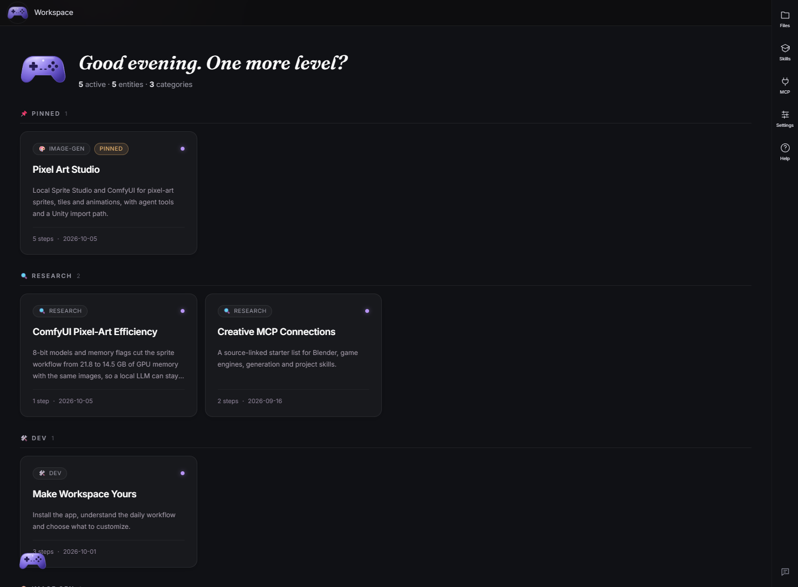

# bunnyUFO Workspace

A web workspace for AI-assisted development: project cards, reports, images and files in a
browser, beside the CLI agents you run in your own terminal. It grew out of game development
and has extra tooling there, but nothing about it is game-only.



## What it is

| Piece | Role |
| --- | --- |
| **The app** (`src/`, `server/`) | A React UI served by one Node service: cards, reports, a file rail, skills and MCP panels, in a browser |
| **Workspaces** | Folders of cards, registered in `~/.buw/workspaces.json`. The app shows one at a time |
| **The published site** (`site/`) | Optional: the same UI served from an S3 bucket of cards, so you can read and pin cards from any device |
| **GPU handoff** ([`tools/gpu`](tools/gpu/guard.mjs)) | Optional: shares one GPU between ComfyUI and local Ollama models, as an MCP server (`gpu_status`, `free_gpu`) and a Claude Code hook |
| **ComfyUI runner** ([`tools/comfy.py`](tools/comfy.py)) | Optional: runs the workflows of a ComfyUI repository checked out next to this one |
| **Asset library** ([`tools/asset-library`](tools/asset-library/README.md)) | Optional: asset packs kept as one zip each in cloud storage; a project pulls in only the packs it uses |

## Prerequisites

- Docker, to run the app. Git and Node.js 22.20+ to work on it.
- At least one agent CLI: [Claude Code](https://code.claude.com/docs/en/setup),
  [Codex CLI](https://developers.openai.com/codex/cli) or [OpenCode](https://opencode.ai/docs/).
- [Ollama](https://ollama.com) for local models, and ComfyUI for the art tools (both optional).

## Run it

```bash
WORKSPACE=/path/to/your-workspace docker compose up -d
# http://127.0.0.1:8300
```

`WORKSPACE` is a folder holding a `workspace.json`; leave it unset to see the two sample cards.
The ports are published on `127.0.0.1` only. Putting the app on a LAN or a public name needs an
authenticating proxy in front. `npm run redeploy -- --app` rebuilds the image and restarts the
container.

To work on the app itself:

```bash
npm ci
npm run dev        # the UI, with hot reload
npm run service    # the Node service it talks to
```

See [getting started](docs/getting-started.md).

## Cards, workspaces and the published site

Your cards are not kept in this repository. Each workspace is a folder of cards, registered in
`~/.buw/workspaces.json` together with the place it publishes to in an S3 bucket,
`s3://<bucket>/sections/<id>`. `workspace/` here holds the site template, the shared report
styles and two sample cards that show the formats.

```bash
npm run workspace                 # which workspace is active, and what is registered
npm run publish                   # upload the active one; --card <id>, --dry-run, --pull, --all
npm run redeploy                  # what is not uploaded yet, and is each section on the site?
npm run docs                      # serve the active workspace locally on :4000 (Docker)
```

Publishing is an upload: `npm run publish` compares the card folders with the bucket and
uploads what differs. There is no commit and no build step; the site reads the bucket, so a
card is live when the command returns. A small service (`site/api`) streams the cards out of
the bucket and keeps pins, archives and tags in `state.json`; Caddy (`site/caddy/`) serves it
together with the app's own UI. See [workspaces](docs/workspaces.md).

## Agents

Agents run in your own terminal, with your own accounts and settings. This repository ships no
agent configuration: add MCP servers, hooks and permissions in your own user settings. A session
started in this folder reads `AGENTS.md` (and `CLAUDE.md` for Claude Code).

If you use the GPU tools, register `node tools/gpu/mcp.mjs` as an MCP server and
`tools/gpu/claude-hook.mjs` as a Claude Code hook in your own settings.

## Skills

Skills are [APM](https://microsoft.github.io/apm/) packages; this repository keeps no copies:

- [`bunnyUFO-lab/workspace-skills`](https://github.com/bunnyUFO-lab/workspace-skills) —
  cards and reports, project hubs, planning, handoffs, dev sprints, dictation setup.
- [`bunnyUFO-lab/gamedev-skills`](https://github.com/bunnyUFO-lab/gamedev-skills) — Unity,
  Blender, 3D production, level design, game UI, VFX, audio, playtesting.
- [`bunnyUFO-lab/art-pipeline-skills`](https://github.com/bunnyUFO-lab/art-pipeline-skills) —
  Sprite Studio pixel art, ComfyUI workflows, fal.ai, Higgsfield, references, video review.

For Claude Code, install the workspace package once as a plugin:

```text
/plugin marketplace add bunnyUFO-lab/workspace-skills
/plugin install bunnyufo@workspace-skills
```

See the [skill index](docs/skills.md).

## Repository map

| Folder | Contents |
| --- | --- |
| `src/`, `server/` | The React UI and the Node service it talks to ([architecture](docs/architecture.md)) |
| `site/` | The published site: its data service (`api/`), Caddy config (`caddy/`) and the card API (`card-api/`) |
| `workspace/` | The Just the Docs site template, shared report styles and two sample cards |
| `projects/` | Longer project source material |
| `processes/`, `knowledge/` | Repeatable workflows and notes |
| `tools/` | Optional integrations: `gpu/`, `comfy.py`, `asset-library/`, a WezTerm config in `wezterm/`, and `workspace/` (redeploy status, bucket setup) |
| `docs/`, `scripts/` | Documentation, and the scripts behind the `npm run` commands |

## Keep it private

`.env`, CLI logins, transcripts, runtime state (`.buw/`) and job receipts stay out of Git.
`.env.example` lists the optional variables with empty values. Review commits for credentials
and personal media before pushing. See [sharing](docs/sharing.md).

## License

MIT, see [LICENSE](LICENSE), and the [third-party notices](THIRD_PARTY_NOTICES.md).
